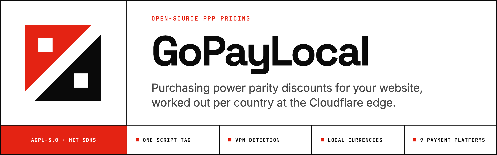

<p align="center">
  <a href="https://gopaylocal.com">
    <picture>
      <source media="(prefers-color-scheme: dark)" srcset=".github/assets/readme-banner-dark.png">
      
    </picture>
  </a>
</p>

<p align="center">
  <a href="https://github.com/RayLabsHQ/gopaylocal/actions/workflows/ci.yml"></a>
  <a href="LICENSING.md"></a>
  <a href="https://www.npmjs.com/package/@gopaylocal/js"></a>
  <a href="https://www.npmjs.com/package/@gopaylocal/react"></a>
  <a href="https://docs.gopaylocal.com/self-hosting/"></a>
</p>

<p align="center">
  <a href="https://gopaylocal.com"><b>Website</b></a> ·
  <a href="https://docs.gopaylocal.com/getting-started/quickstart/"><b>Quickstart</b></a> ·
  <a href="https://docs.gopaylocal.com"><b>Docs</b></a> ·
  <a href="https://docs.gopaylocal.com/self-hosting/"><b>Self-hosting</b></a> ·
  <a href="CONTRIBUTING.md"><b>Contributing</b></a> ·
  <a href="ROADMAP.md"><b>Roadmap</b></a>
</p>

Purchasing power parity (PPP) discounts for your website. GoPayLocal reads each
visitor's country at the Cloudflare edge, works out a discount for that country, creates
a matching coupon code in your payment platform and shows it in a small banner. Visitors
on known VPN, Tor or datacenter networks get no discount.

GoPayLocal is open source. You can use the hosted version at
[gopaylocal.com](https://gopaylocal.com) or run it yourself on your own Cloudflare
account.

## How it works

```html
<script src="https://api.gopaylocal.com/v1/banner/script.js?key=gpl_pk_YOUR_PUBLIC_KEY" async></script>
```

1. The script tag loads the banner (under 4 KB gzipped; it renders in a closed Shadow
   DOM, so it does not touch your page's CSS).
2. The banner asks the API for this visitor's offer. The API reads the country from the
   Cloudflare request, checks the visitor's network against VPN, Tor and datacenter lists,
   and picks the campaign for your product.
3. The discount comes from the campaign's pricing mode (per-country PPP multipliers,
   discount tiers, or per-country overrides), capped at the campaign's maximum discount.
   Built-in PPP data covers 75 countries; visitors from anywhere else get no discount.
4. The first time a country needs a code, GoPayLocal creates it in your connected payment
   platform and reuses it for later visitors from that country.
5. The banner shows the code with a Copy button. If you build your own checkout, the
   JavaScript or React SDK gives you the code so your checkout can apply it for the buyer.
6. Banner impressions, clicks and code copies are recorded per country. Redemptions
   arrive through your payment platform's webhooks.

Other features: A/B tests that split a product's visitors between two campaigns (sticky
per visitor) and show the two campaigns' numbers side by side; holiday deals (a sale with
a first and a last day and one code, where each visitor is offered the larger of the deal
and their country's discount); local prices in the
visitor's currency, converted at the day's exchange rate and rounded with the campaign's
charm pricing (estimates: your payment platform still charges your own currency);
per-product campaigns; test-mode campaigns that do not count against your plan; team
members with roles; per-campaign banner settings (message, colours, position); and a
management API for products, campaigns, A/B tests and analytics, called with a secret key.

## Integrations

Stripe, Paddle, Gumroad, Chargebee, Dodo Payments, Polar, Whop, Creem and WooCommerce.

Each integration has unit tests and fixture-based contract tests, but none has yet been
verified against a live merchant account. The status of each provider, and the tool for
checking one against your own sandbox account, are in
[`apps/api/PROVIDER_VERIFICATION.md`](apps/api/PROVIDER_VERIFICATION.md).

## Plans

| | Free | Pro | Self-hosted |
|---|---|---|---|
| Price | $0 | $19/month | $0 (you pay your own Cloudflare and Postgres costs) |
| Products | 1 | Unlimited | Unlimited |
| API calls per month | 10,000 | 20 million (contact us for more) | Unlimited |
| Team members | 1 | Unlimited | Unlimited |
| Analytics history | 7 days | 365 days | Unlimited |
| "Powered by GoPayLocal" link on the banner | Shown | Removed | Removed |
| Billing | None | Dodo Payments | Disabled |

Every feature is available on every plan, including Free. One API call is one request
for a visitor's offer (`GET /v1/banner/config/...`) that reaches campaign selection.
Script loads, analytics events, VPN-flagged visitors and test-mode campaigns are not
counted. When a Free account passes 10,000 calls in a calendar month (UTC), the banner
stops showing until the next month or an upgrade. Pro includes 20 million calls a month and is not
cut off above that (contact us if you expect more). The limits are enforced
from `PLAN_LIMITS` in
[`packages/shared/src/constants/index.ts`](packages/shared/src/constants/index.ts).

## Quick start (hosted)

1. Sign in at [app.gopaylocal.com](https://app.gopaylocal.com) with Google or GitHub.
2. Add a product, then connect your payment platform under **Integrations**.
3. Create a public API key under **Settings > API keys**.
4. Create a campaign for the product and set it to active.
5. Copy the snippet from the campaign page (it fills in your public key and product id)
   into your site's `<head>` or before `</body>`.

The [quickstart](https://docs.gopaylocal.com/getting-started/quickstart/) has the details,
and [docs.gopaylocal.com](https://docs.gopaylocal.com) covers the SDKs, the
integrations and the API.

## Self-hosting

A self-hosted install runs the same code with `SELF_HOSTED="true"`: every organization
is unlimited, the banner has no GoPayLocal link, and billing is switched off. You need a
Cloudflare account (Workers Paid is recommended; on Workers Free the daily VPN-list
refresh runs from a GitHub Actions job instead of the Worker),
Postgres 15 or newer reachable over TLS, and a Google or GitHub OAuth app.

The setup guide is at
[docs.gopaylocal.com/self-hosting](https://docs.gopaylocal.com/self-hosting/), and
[`apps/api/wrangler.example.toml`](apps/api/wrangler.example.toml) is the configuration
template, with a comment on every setting.

## Repository layout

```
apps/
  api/        Cloudflare Worker (Hono): banner serving, REST API for the dashboards,
              sign-in (Better Auth), payment integrations, webhooks, cron jobs
  dashboard/  Merchant dashboard (React, TanStack Start in SPA mode, shadcn/ui)
  admin/      Platform admin dashboard (same stack)
  web/        Marketing site (Astro)
  docs/       Documentation site (Astro Starlight)
packages/
  shared/     Types, constants (including plan limits), PPP data, Zod schemas
  banner/     The embeddable banner script
  js-sdk/     @gopaylocal/js, the browser SDK
  react-sdk/  @gopaylocal/react, React provider, hooks and components
e2e/          Playwright end-to-end tests (run locally, not in CI)
```

The API stores data in Postgres (through Cloudflare Hyperdrive) and uses Workers KV for
caching and the VPN lists. The dashboards, marketing site and docs are deployed as
Workers with static assets. The SDKs are on npm as
[`@gopaylocal/js`](https://www.npmjs.com/package/@gopaylocal/js) and
[`@gopaylocal/react`](https://www.npmjs.com/package/@gopaylocal/react).

## Development

[CONTRIBUTING.md](CONTRIBUTING.md) covers the local setup: Node.js (the version in
[`.nvmrc`](.nvmrc)), pnpm 12, Docker for the local Postgres databases, and how to sign in
locally.

```sh
pnpm install
pnpm build:banner      # the API serves the built banner bundle

pnpm typecheck
pnpm test:shared
pnpm test:sdk
pnpm test:api

# Integration tests need the test database from docker-compose.yml
pnpm db:test:up
pnpm db:test:migrate
pnpm test:integration
```

## License

GoPayLocal is licensed per directory:

- everything under `apps/` (the API, dashboards, marketing site and docs) is
  [AGPL-3.0-only](LICENSE);
- everything under `packages/` (the banner, the SDKs and the shared package) is MIT (see
  the `LICENSE` file in each package).

[LICENSING.md](LICENSING.md) explains what that means for merchants embedding the banner
or an SDK and for anyone running their own copy of the service. Third-party data used at
runtime, including the IPLocate data in the VPN lists, is credited in [NOTICE](NOTICE).

## Security

Please report vulnerabilities privately to security@gopaylocal.com or through GitHub's
private vulnerability reporting. [SECURITY.md](SECURITY.md) has the details.

## Credits

GoPayLocal is built by the RayLabs team.
